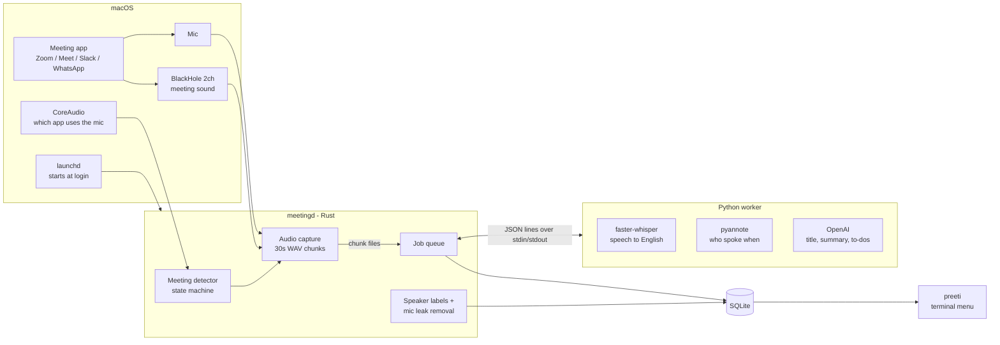
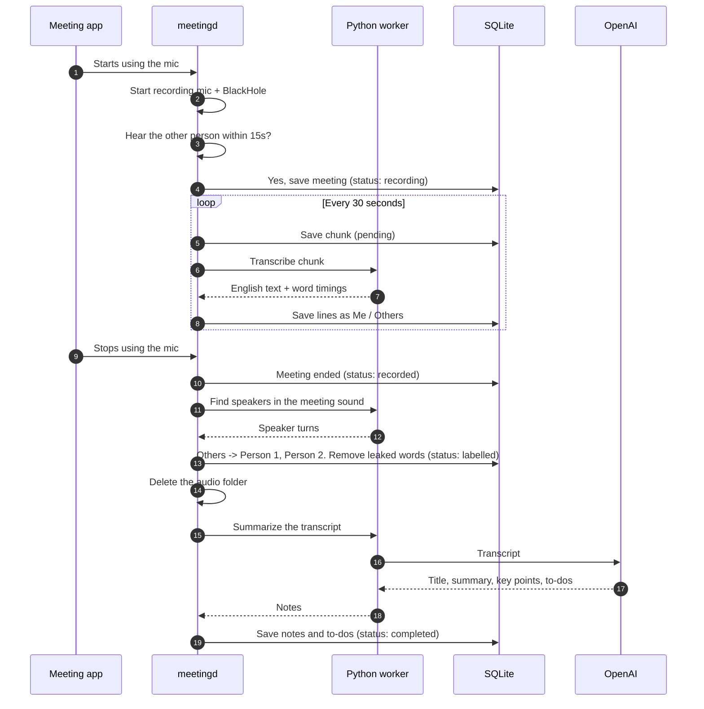

# Preeti

I attend a lot of meetings in a day, and I can't note down everything. I also don't want to pay a subscription for a note-taking tool. So I built Preeti for myself.

Preeti runs in the background on my Mac. Whenever a meeting starts on Zoom, Google Meet, Slack, WhatsApp or any other app, it records the call on its own. When the meeting ends, it turns the call into English text, finds who spoke, and writes a title, a summary and my to-dos. Everything is stored in a local database, and I can read it from the terminal with one command: `preeti`.

I don't need to open anything or press any button before a meeting. Once it is set up, it just works.

---

## What it does

- Starts on its own when I log in to the Mac.
- Finds when a meeting starts, and records my mic and the meeting sound.
- Skips things that are not meetings, like voice notes, dictation in VS Code, or ChatGPT voice.
- Turns speech into English text. People speak Hindi, Hinglish and English in my meetings, so everything is translated to English.
- Finds who spoke: `Me` for me, and `Person 1`, `Person 2`… for others.
- Removes my speaker sound that leaks into my mic, so the same line is not saved twice.
- Sends the transcript to OpenAI and gets back a title, a summary, key points and my to-dos.
- Deletes the audio once the notes are ready. Only the text is kept.
- Lets me read meetings and to-dos, and mark each to-do as keep, done or drop, from the `preeti` menu.

---

## Architecture

There are two main parts:

- **`meetingd`** (Rust): the background daemon. It watches for meetings, records audio, keeps the job queue in SQLite, and runs the Python worker.
- **Python worker**: does all the AI work. Whisper for text, pyannote for speakers, OpenAI for notes.

I kept them separate because the AI models are heavy and the Python ML libraries are the best for them. Rust keeps the always-running part small and stable. The models are loaded only once, when the worker starts.



### How one meeting goes



### How it finds a meeting

The tricky part is that I also use the mic for other things: dictation in VS Code, ChatGPT voice, and WhatsApp voice notes. I don't want those recorded. So two checks must both be true:

1. **An allowed meeting app is using the mic.** macOS can tell which app is using the mic without recording anything. VS Code, ChatGPT, Codex and Claude are on an ignore list.
2. **I can hear the other person.** In a real call, the other person's voice comes into my Mac, so the meeting sound (BlackHole) gets loud. In a voice note or dictation, only I talk.

Let's say I record a WhatsApp voice note. WhatsApp is an allowed app, so recording starts. But nobody else talks, so after 30 seconds it is thrown away and the audio is deleted. If it is a WhatsApp call, my friend's voice comes in, so after 15 seconds it becomes a meeting.

The detector is a small state machine:

```text
Idle -> Starting -> Recording -> Idle
            |            |
            v            v
        discarded      ended
       (not a call)  (app let go of the mic for 10s,
                      or 90s of silence)
```

Recording starts in `Starting`, so the first 15 seconds of the meeting are not lost.

### Meeting status

| Status | Meaning |
|---|---|
| `recording` | Meeting is going on |
| `recorded` | Meeting ended, chunks are being turned into text |
| `labelled` | Speakers found, leak removed, audio deleted |
| `label_failed` | Speaker step failed. The text is still there, just without names |
| `completed` | Title, summary and to-dos are saved |
| `summary_failed` | OpenAI step failed. The error is saved. Retry with `preeti resummarize <id>` |

### To-do status

| Mark | Status | Meaning |
|---|---|---|
| `•` | `suggested` | Picked by the AI, I have not checked it yet |
| `✔` | `kept` | Real task, still open |
| `☑` | `done` | Finished |
| `✘` | `dropped` | Wrong or not needed |

The AI can be wrong, so every to-do keeps the line from the transcript it came from. I decide what to keep.

---

## Models

All speech models run locally on my Mac. Only the transcript text goes to OpenAI.

| Model | What I use it for | Where it runs |
|---|---|---|
| [`Systran/faster-whisper-medium`](https://huggingface.co/Systran/faster-whisper-medium) | Speech to text. Set to `translate`, so Hindi and Hinglish come out in English | Local, CPU, int8 |
| [`pyannote/speaker-diarization-community-1`](https://huggingface.co/pyannote/speaker-diarization-community-1) | Finds who spoke when in the meeting sound | Local, Mac GPU (MPS) |
| OpenAI `gpt-5-mini` | Title, topics, summary, key points and my to-dos | OpenAI API |

Why `medium` and not `large-v3-turbo`: medium is good enough to test the full pipeline, and it was already on disk. The model path is in the config, so I can change it later if the quality is not good.

On my Mac mini (M4), a 30-second chunk takes about 6-7 seconds to turn into text. Finding speakers takes about 7 seconds for a short call.

---

## Libraries

### Rust (`meetingd`)

| Crate | What I use it for |
|---|---|
| `cpal` | Records the mic and BlackHole |
| `rubato` + `audioadapter-buffers` | Converts 48 kHz audio to 16 kHz, which Whisper needs |
| `hound` | Writes the WAV chunk files |
| `rusqlite` (bundled) | SQLite database: meetings, chunks, transcript lines, to-dos |
| `clap` | Commands like `run`, `list`, `todos`, `keep` |
| `dialoguer` + `console` | The `preeti` menu with arrow keys and colours |
| `serde`, `serde_json`, `toml` | Config file and the JSON messages to the worker |
| `tracing`, `tracing-subscriber`, `tracing-appender` | Logs, one file per day, last 7 days kept |
| `chrono` | Meeting times |
| `ctrlc` | Stops cleanly on Ctrl+C and on logout |
| `dotenvy` | Loads the `.env` file |
| `anyhow` | Error handling |

`meetingd` also calls macOS CoreAudio directly to find which app is using the mic. This needs macOS 14 or newer.

### Python (worker)

| Library | What I use it for |
|---|---|
| `faster-whisper` | Speech to English text, with word timings |
| `pyannote-audio` (+ `torch`) | Speaker diarization |
| `openai` | Title, summary and to-dos, as structured output |
| `numpy` | Reads the WAV chunks into audio arrays |

`worker/pyproject.toml` also lists `whisperx`, `mlx-whisper`, `rich` and `typer`. They are not used right now.

---

## What you need on the Mac

| Need | Why |
|---|---|
| Apple Silicon Mac, macOS 14 or newer | CoreAudio mic check, and MPS for pyannote |
| [Homebrew](https://brew.sh) | To install the tools below |
| [BlackHole 2ch](https://github.com/ExistentialAudio/BlackHole) | Gives the meeting sound to the app as an input |
| Rust (via [rustup](https://rustup.rs)) | Builds `meetingd` |
| [`uv`](https://docs.astral.sh/uv/) | Python environment for the worker |
| Python 3.13 | The worker (`uv` can install it) |
| Hugging Face account | To download the two models (accept the pyannote model terms first) |
| OpenAI API key | For the notes and to-dos |
| `ffmpeg` (optional) | Only for testing audio by hand |

```bash
brew install blackhole-2ch uv ffmpeg
curl --proto '=https' --tlsv1.2 -sSf https://sh.rustup.rs | sh
```

---

## Setup

### 1. Audio routing (one time)

The meeting sound must go to the speakers **and** to BlackHole at the same time.

1. Open **Audio MIDI Setup**.
2. Click **+** at the bottom, then **Create Multi-Output Device**.
3. Tick your speakers or headphones, and **BlackHole 2ch**.
4. Rename it to `Meeting Capture Output`.
5. In **System Settings → Sound → Output**, pick `Meeting Capture Output`.

Keep the output on `Meeting Capture Output`. If you switch to only speakers or headphones, BlackHole hears nothing, and calls look like voice notes.

Use headphones if you can. Without them, the other person's voice from the speakers also goes into the mic. Preeti removes most of this, but headphones give the cleanest text.

### 2. Download the models

```bash
pip install -U huggingface_hub   # or: uvx --from huggingface_hub hf
hf auth login
hf download Systran/faster-whisper-medium --local-dir /Volumes/T7/Local-Model/whisper/faster-whisper-medium
hf download pyannote/speaker-diarization-community-1 --local-dir /Volumes/T7/Local-Model/pyannote/speaker-diarization-community-1
```

You can keep the models anywhere. Just put the same paths in the config.

### 3. Python worker

```bash
cd worker
uv sync
```

### 4. Keys and config

```bash
echo 'OPENAI_API_KEY=sk-...' > .env
cp config/config.example.toml config/config.toml
```

In `config/config.toml`, check these:

- `whisper_model_path` and `pyannote_model_path`: where you downloaded the models.
- `mic_device`: your mic name. Run `cargo run -- devices` to see the names.
- `meeting_apps`: run `cargo run -- mic-users` during a call to see your app's exact name. For example, I had to add `Brave Browser`.

### 5. Install

```bash
scripts/install.sh
```

This builds the release binary, copies it to `~/Library/Application Support/Preeti/bin/meetingd`, registers it with launchd so it starts at every login, and installs the `preeti` command in `~/.local/bin`.

### 6. Allow permissions

macOS asks for these once. Click **Allow**.

| Permission | When it asks | If you missed it |
|---|---|---|
| Microphone for `meetingd` | On the first meeting | System Settings → Privacy & Security → Microphone |
| Removable Volumes for `meetingd` | At first start, only if the repo or models are on an external drive | System Settings → Privacy & Security → Files and Folders |

After every `scripts/install.sh`, macOS may ask again, because the new binary counts as a new app.

---

## Using it

After setup, there is nothing to do before a meeting. Just join the call.

To read the notes, open any terminal and run:

```bash
preeti
```

```text
Preeti · meeting notes   ● Recording meetings automatically
3 meetings  ·  2 open tasks  ·  1 to review

❯ Last meeting: summary
  Last meeting: to-dos
  My open to-dos (mark done)
  All to-dos
  Review to-dos (keep / drop)
  Browse meetings
  Pause recording
  Quit
```

Use ↑ ↓ to move, Enter to open, and Esc or `q` to go back.

Quick commands without the menu:

| Command | What it does |
|---|---|
| `preeti last` | Summary and to-dos of the last meeting |
| `preeti tasks` | My open to-dos |
| `preeti todos` | All to-dos, with their `#` numbers |
| `preeti keep 3` / `done 3` / `drop 3` | Change a to-do |
| `preeti list` | All meetings |
| `preeti show <id>` | Notes, to-dos and full transcript of one meeting |
| `preeti resummarize <id>` | Ask OpenAI again for the notes |
| `preeti pause` / `resume` | Stop or start recording meetings |

To stop it fully: `scripts/uninstall.sh`. Meetings and notes are kept.

---

## Where things are stored

| What | Where |
|---|---|
| Database | `~/Library/Application Support/Preeti/meetings.db` |
| Audio while a meeting is processed | `~/Meetings/<meeting-id>/mic/` and `system/` (deleted after) |
| Logs | `~/Library/Logs/Preeti/meetingd.YYYY-MM-DD.log` (last 7 days) |
| Installed daemon | `~/Library/Application Support/Preeti/bin/meetingd` |
| launchd job | `~/Library/LaunchAgents/com.preeti.meetingd.plist` |

Audio is about 230 MB per hour while a meeting is processed, and then it is deleted. The text is about 400 KB per hour, so a full year of daily meetings is around 500 MB.

---

## Reliability

- **Crash or power cut during a meeting:** on the next start, the meeting is closed, the half-written WAV file is repaired, and processing continues.
- **Python worker crash:** `meetingd` restarts it and tries the chunk again. After 3 failed tries, the chunk is skipped so one bad file can't block the queue.
- **Two daemons:** a lock file makes sure only one `meetingd run` is running.
- **Mic unplugged:** detection waits 30 seconds before trying again, instead of trying every second.
- **External drive not mounted at login:** launchd tries again every 30 seconds.
- **Whisper making up lines on silence** (like "Thanks for watching!"): these are dropped.

---

## Project layout

```text
Preeti/
  meetingd/                 Rust daemon and the preeti CLI
    src/
      main.rs               commands and the daemon loop
      audio/                mic + BlackHole capture, 16 kHz WAV chunks, sound level
      detect/               meeting state machine, which app is using the mic
      meeting.rs            one capture: start, confirm, discard, finish
      worker.rs             runs the Python worker, job queue
      labels.rs             speaker names and mic leak removal
      recover.rs            lock, crash recovery, cleanup
      db.rs                 SQLite
      cli.rs                the preeti menu
      view.rs               how meetings and to-dos are printed
    Info.plist              lets macOS ask for mic permission
  worker/                   Python ML worker
    src/
      __main__.py           reads requests, sends replies
      transcribe.py         faster-whisper
      diarize.py            pyannote
      summarize.py          OpenAI notes and to-dos
      protocol.py           JSON lines over stdin/stdout
  config/config.example.toml
  launchd/                  launchd job template
  scripts/                  install, install-cli, uninstall
  docs/PRD.md               the first plan
```

---

## Known limits

- `Person 1`, `Person 2` are numbers, not real names. pyannote can't know who is who.
- If I and the other person say the same word at the same moment, my word may be removed as a leak.
- Due dates are kept as said in the meeting ("Friday", "tomorrow"), not as real dates.
- The transcript goes to OpenAI for the notes. The audio never leaves the Mac.
- I have tested it on my Mac mini with Brave (Google Meet). Other apps are in the list, but I have not tested each one yet.
