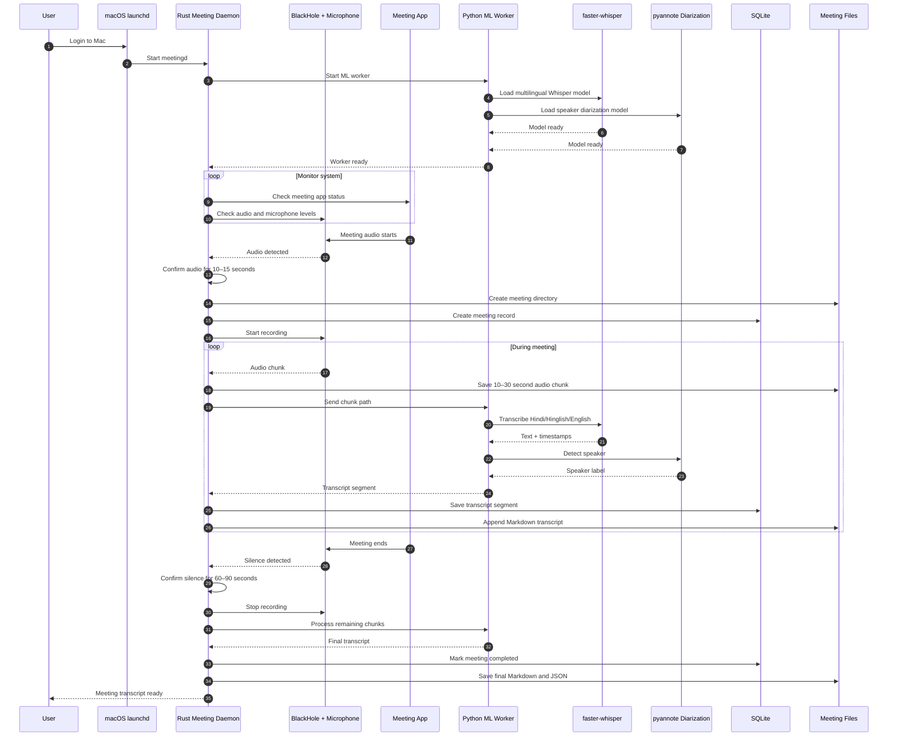

Yes. Rust is useful, but you should not rewrite the AI models in Rust initially.

The best architecture is:

```text
Rust daemon
  ├── Detect meeting/audio activity
  ├── Capture microphone + BlackHole audio
  ├── Run silence/VAD checks
  ├── Manage recording files
  ├── Monitor Chrome, Slack, Zoom, WhatsApp, Telegram
  └── Start/stop the Python worker

Python worker
  ├── faster-whisper transcription
  ├── WhisperX alignment
  ├── pyannote speaker diarization
  └── JSON/Markdown transcript generation
```

Rust can improve:

- Background daemon memory usage
- Audio capture stability
- Audio-level detection
- Meeting start/stop detection
- Process monitoring
- File handling
- Bounded queues and buffering
- CLI responsiveness
- Crash recovery

Rust will not significantly reduce the RAM used by:

```text
Whisper model
pyannote model
PyTorch
```

Those models dominate memory usage. For example, the `medium` model and PyTorch will use much more RAM than the Rust daemon.

Recommended Rust crates:

```toml
[dependencies]
tokio = { version = "1", features = ["full"] }
cpal = "0.15"
hound = "3.5"
serde = { version = "1", features = ["derive"] }
serde_json = "1"
rusqlite = "0.32"
sysinfo = "0.30"
clap = { version = "4", features = ["derive"] }
tracing = "0.1"
anyhow = "1"
```

Their roles:

```text
cpal          Microphone/BlackHole audio capture
hound         WAV writing
tokio         Background async daemon
sysinfo       Detect active meeting applications
rusqlite      Store meeting metadata/transcripts
clap          Rust CLI
serde         Configuration and JSON
tracing       Logs
```

Use IPC between Rust and Python:

```text
Rust daemon
    ↓ Unix socket or subprocess pipe
Python ML worker
    ↓
Transcript events
```

For example, Rust sends:

```json
{
  "meeting_id": "2026-11-18-001",
  "audio_file": "/Users/jay/Meetings/001/chunk-0001.wav",
  "start_time": 0,
  "end_time": 30
}
```

Python returns:

```json
{
  "speaker": "SPEAKER_00",
  "text": "Aaj hum next step discuss karenge",
  "start": 2.4,
  "end": 7.8
}
```

Keep the Python worker alive for the entire session so the models are loaded only once:

```text
Mac login
  ↓
Rust daemon starts
  ↓
Python worker starts
  ↓
Models load once
  ↓
Meetings start and stop automatically
```

For a Mac-specific optimization, consider `whisper.cpp` with Metal acceleration. It can use quantized models and reduce memory, but integrating speaker diarization and Hindi/Hinglish handling is more complicated. Therefore, I recommend:

```text
Version 1:
Rust daemon + Python faster-whisper + pyannote

Version 2:
Rust daemon + whisper.cpp/Metal + Python pyannote

Version 3:
Fully Rust pipeline, only if performance requires it
```

The biggest practical optimization is to use a bounded audio queue:

```text
Maximum queue: 2–3 audio chunks
```

If transcription is slow, do not keep unlimited audio in RAM. Write chunks directly to disk and let Python process them sequentially. This prevents memory growth during long meetings.


It is called a **UML Sequence Diagram**. You can write it using **Mermaid** syntax.



The overall flow is:

```text
Mac login
  ↓
Rust daemon starts
  ↓
Python models load once
  ↓
Audio and meeting apps monitored
  ↓
Meeting detected
  ↓
Audio chunks recorded
  ↓
Whisper transcribes
  ↓
pyannote identifies speakers
  ↓
Transcript saved
  ↓
Silence detected
  ↓
Meeting closed automatically
```

Use the term **UML Sequence Diagram**, not DML or SQL.